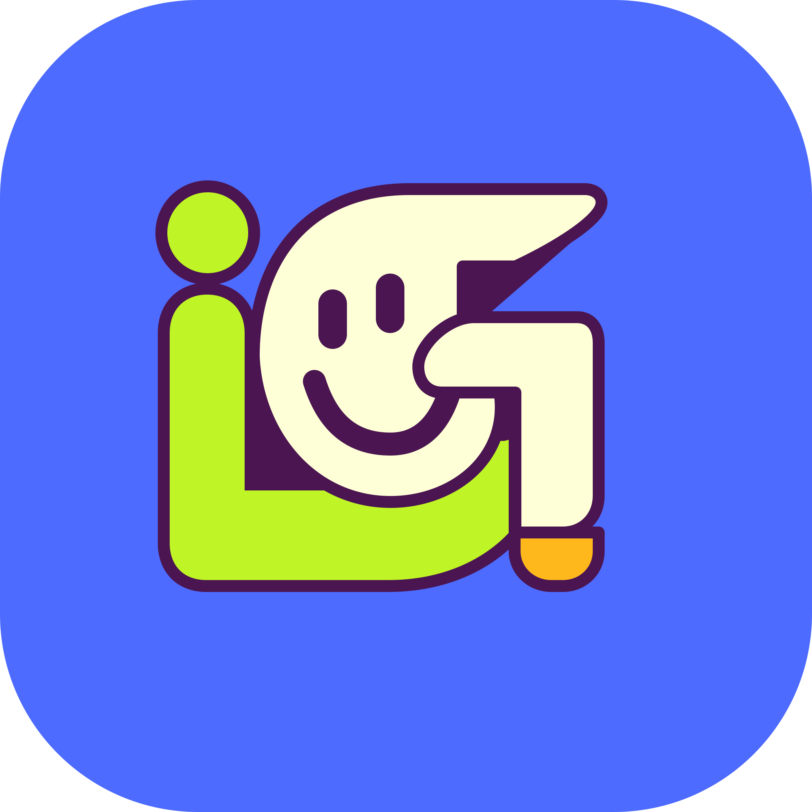
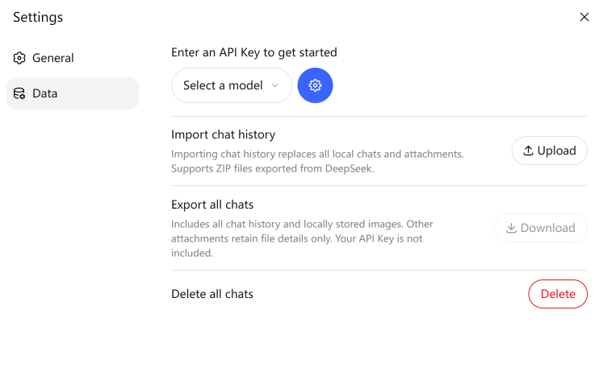

<p align="left"></p>

# iGood Studio | DeepDemo

[English]| [简体中文](README_ZH.md)

The UI of this project is adapted from [DeepSeek Chat Demo](https://github.com/deepseek-ai/chat-demo) (official v0.1.1 build) under the MIT License. Original copyright belongs to [DeepSeek](https://github.com/deepseek-ai). The current version is maintained and modified by [iGood Studio](https://github.com/igoodz-top).

## What is this

A customized build of the official DeepSeek Chat Demo. The official compiled bundle in `static/` is untouched; a bridge script in `index.html` turns the DeepSeek-only chat page into a front-end for any OpenAI / Anthropic compatible API.

## Features

- Custom models: API format (OpenAI Chat Completions / OpenAI Responses API / Anthropic Messages), base URL (trailing slash stripped, endpoint path appended automatically, never doubled), model ID, display name, API key, temperature (0-2), system prompt (omitted when empty). The module UI follows the app language (zh/en).
- Multi-model management: save several configurations and switch anytime. Configs live in browser localStorage (`api_config_model_list`); keys stay on your machine.
- Connection test: format-aware probe with latency readout. Failures show the actual request URL for debugging.
- Request rerouting: in-page chat traffic is forwarded to the selected custom model, streaming and reasoning included, with stop support.
- Branding: sidebar logo plus DeepDemo, tab title and favicon, open-source attribution at the sidebar bottom (bilingual, follows app language).

## Settings preview

Open Settings > Data. The API-key input is replaced by the model selector and gear. The module entry lives here and on the gate screen only, no floating button elsewhere.



## Quick start

1. Serve this directory with any static host, or open `index.html` directly:
   ```
   npx serve .
   ```
2. Fill in your API details at the gate ("Enter an API Key to get started") or in Settings > Data, then save
3. Pick a model and start chatting

This is a pure front-end, direct-from-browser setup. The target API must allow CORS, otherwise requests fail. A self-hosted reverse proxy solves this.

## Fork / redistribution requirements

This project stays MIT. The only hard obligation downstream is keeping the full `LICENSE` file with both the DeepSeek and iGood Studio copyright lines. On top of that:

- Must keep: the `LICENSE` dual-copyright notice, and the first two attribution lines ("UI adapted from DeepSeek Chat Demo under the MIT License" and "Original copyright belongs to DeepSeek"). These are MIT's required notices.
- Replace, do not keep verbatim: the third line "current version maintained and modified by iGood Studio". After a fork the maintainer is you; keeping the original wording is a false attribution. Put your own name there.
- Do not use: the iGood Studio name and logo (`logo.svg`) are trademarked and not licensed by MIT. Use your own branding in forks.

Correct fork shape: DeepSeek copyright kept, LICENSE dual notice kept, first two attribution lines kept, third line and logo replaced with your own.

## Upstream relationship / License

- `static/` matches the official Release [`chat-demo-v0.1.1.zip`](https://github.com/deepseek-ai/deepseek-chat-demo/releases) and is unmodified.
- Upstream is MIT. The `LICENSE` file must be kept as-is; you may not relicense or remove the copyright notice. That is MIT's only obligation. Commercial use, closed redistribution, and renaming are allowed.
- This project is distributed as a standalone repository, not a GitHub fork. What ships is the official build plus the bridge layer, which differs structurally from the upstream source repo, so a fork would offer no diff or sync value. To upgrade: extract a new Release over `static/`, restore the head script tag in `index.html`, and keep the bridge (self-contained in `index.html` plus `api/`).
- If you need to modify the UI source itself (beyond the bridge), fork the upstream source repo and ship a full `pnpm build` instead.

## Layout

```
index.html          Entry + bridge script (branding / gate unlock / fetch reroute)
logo.svg            Favicon and sidebar logo
screenshot/         Settings screenshots (zh / en)
api/                Custom-model module (dependency-free UMD)
  api-config.js       window.ApiConfig: model config, switching, connection test, streamChat
  api-config.css      Module styles (follows host design tokens and dark mode)
  README.md           Module API documentation (English)
  README_ZH.md        Module API documentation (Chinese)
static/             Official DeepSeek Chat Demo build (v0.1.1, unmodified)
LICENSE             MIT (dual copyright notice)
```

## License

MIT, see [LICENSE](LICENSE). UI bundle copyright belongs to DeepSeek; bridge and module code (c) iGood Studio.
