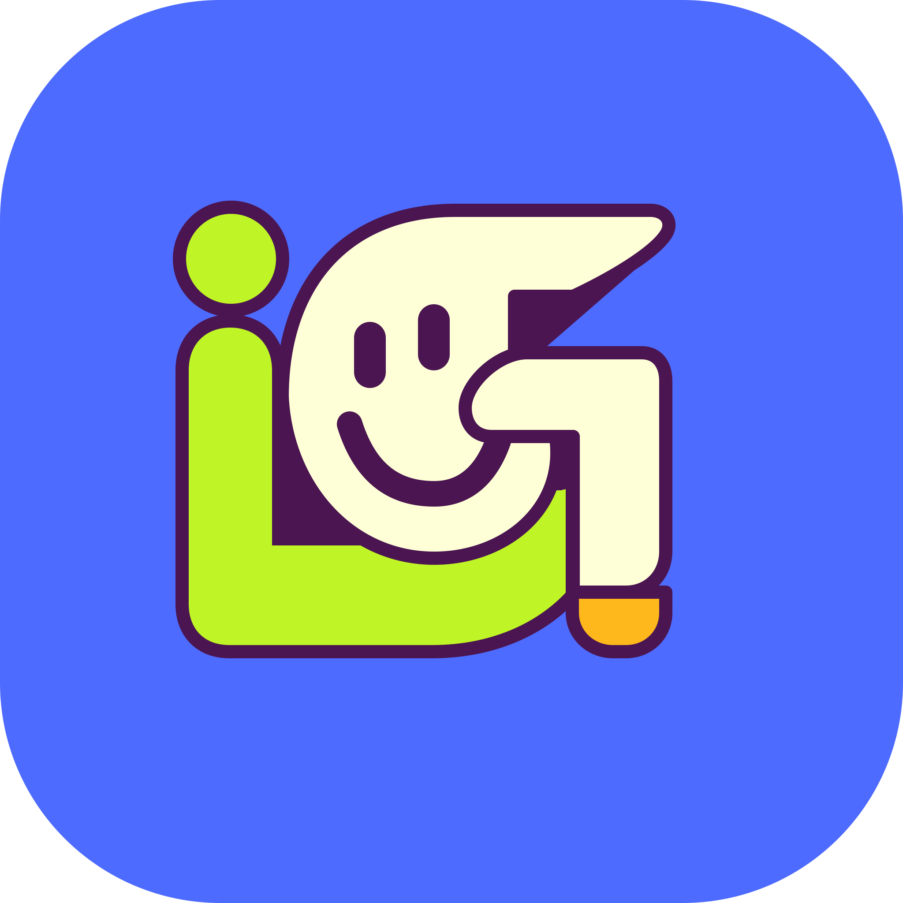
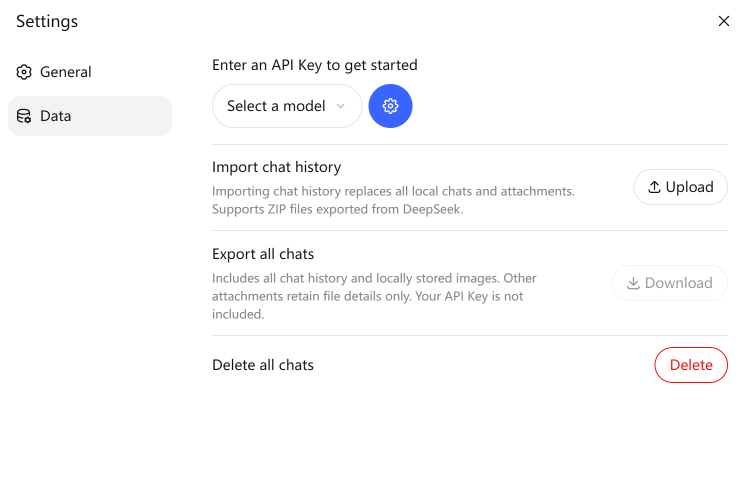

<p align="left"></p>

# iGood Studio | DeepDemo

[English](README.md) | 简体中文

本项目的 UI 界面基于 [DeepSeek Chat Demo](https://github.com/deepseek-ai/chat-demo)（v0.1.1 官方构建产物）修改而来，遵循 MIT 开源协议。原作者版权归 [DeepSeek](https://github.com/deepseek-ai) 所有，当前版本由 [iGood Studio](https://github.com/igoodz-top) 维护和修改。

## 这是什么

DeepSeek 官方 Chat Demo 的定制版。官方编译产物 `static/` 保持原样不动，`index.html` 内注入的桥接脚本把原本只能连 DeepSeek 的对话页改造成可接入任意 OpenAI / Anthropic 兼容 API 的通用模型对话站。

## 功能

- 自定义模型：API 格式（OpenAI Chat Completions / OpenAI Responses API / Anthropic Messages）、请求地址（尾斜杠自动去除，接口路径自动补全且不重复拼接）、模型 ID、展示名称、API 密钥、Temperature（0-2）、System 提示词（留空则不发送）。界面跟随 App 语言自动中英切换。
- 多模型管理：保存多个模型配置，随时切换。配置存于浏览器 localStorage（`api_config_model_list`），密钥仅存本机。
- 连通测试：按所选格式构造真实探针请求，显示耗时；失败时给出实际请求 URL 便于排查。
- 请求改道：页面内对话请求自动转发到当前选中的自定义模型，含流式与思考链，支持停止生成。
- 品牌化：侧边栏 logo 加 DeepDemo，页签标题与图标，左下角开源署名（随语言切换中英）。

## 设置界面预览

打开 设置 > 数据管理。原「API Key 输入框」已被模型选择器和齿轮取代。模块入口只在这里与门禁屏出现，其他界面没有悬浮按钮。



## 快速开始

1. 用任意静态服务器托管本目录，或直接双击 `index.html`：
   ```
   npx serve .
   ```
2. 打开页面，在「输入 API Key 开始使用」处（或 设置 > 数据管理）填写 API 信息并保存
3. 选择模型，开始对话

本站为纯前端直连模式，目标 API 服务需允许浏览器跨域（CORS）访问，否则请求会失败，可自建反向代理解决。

## Fork / 二次分发要求

本项目沿用 MIT 协议，下游分发唯一的硬性义务是保留 `LICENSE` 文件全文（含 DeepSeek 与 iGood Studio 两行版权声明）。在此基础上：

- 必须保留：`LICENSE` 双版权声明，以及界面署名前两行（「UI 界面基于 DeepSeek Chat Demo 修改而来，遵循 MIT 开源协议」「原作者版权归 DeepSeek 所有」）。这两行是 MIT 要求的出处声明。
- 请替换，不要保留原样：第三行「当前版本由 iGood Studio 维护和修改」。fork 之后维护者是你，保留原句构成虚假署名，请改成你自己的名称。
- 请勿使用：iGood Studio 的名称与 logo（`logo.svg`）受商标权保护，不属于 MIT 授权范围，fork 请换成自己的标识。

fork 的正确形态：保留 DeepSeek 版权，保留 LICENSE 双版权行，出处声明前两行照抄，第三行署名与 logo 换成你自己的。

## 与上游的关系 / 许可证

- `static/` 与官方 Release [`chat-demo-v0.1.1.zip`](https://github.com/deepseek-ai/deepseek-chat-demo/releases) 内容一致，未做任何修改。
- 上游为 MIT 协议，`LICENSE` 文件必须原样保留，不得替换为其他协议或删除署名，这是 MIT 唯一的义务。可以在其基础上商用、闭源分发、改名发布。
- 本项目以独立仓库（而非 GitHub Fork）方式分发：分发物是官方编译产物加桥接层，与上游源码仓库结构不同，Fork 反而无法对比与同步。升级上游时：下载新版 Release zip 覆盖 `static/`，恢复 `index.html` 的 head 引导行，桥接脚本保持不变即可（桥接自包含于 `index.html` 与 `api/`）。
- 若未来需要修改界面源码本身（而非桥接层），再考虑 Fork 上游源码仓库并从 `pnpm build` 出完整定制版。

## 目录结构

```
index.html          入口 + 桥接脚本（品牌化 / 门禁解锁 / fetch 改道）
logo.svg            站点图标与侧边栏 logo
screenshot/         设置界面截图（中 / 英）
api/                自定义模型模块（零依赖 UMD）
  api-config.js       window.ApiConfig：模型配置、切换、连通测试、streamChat
  api-config.css      模块样式（自动跟随宿主设计令牌与深浅色）
  README.md           模块 API 文档（英文）
  README_ZH.md        模块 API 文档（中文）
static/             DeepSeek Chat Demo 官方编译产物（v0.1.1，未修改）
LICENSE             MIT（双版权声明）
```

## 许可证

MIT，见 [LICENSE](LICENSE)。UI 编译产物版权归 DeepSeek；桥接脚本与模块代码 (c) iGood Studio。
